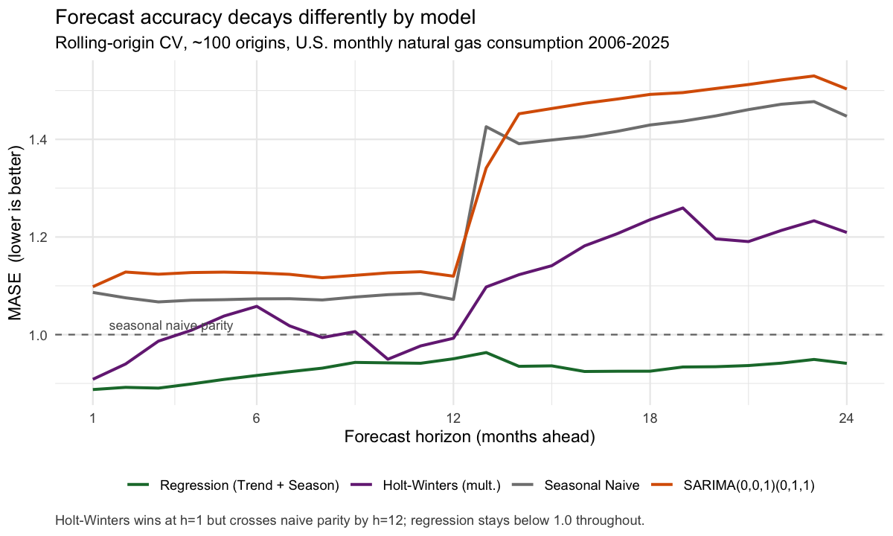

# Does the winning forecast model survive a different test window?

I built a forecasting study for U.S. monthly natural gas consumption that concluded
multiplicative Holt-Winters was the best model, beating SARIMA and a seasonal naive
benchmark on a 24-month holdout. This repository re-runs that comparison under
**rolling-origin cross-validation across ~100 origins** instead of one.

**The ranking reverses.** Holt-Winters, the holdout winner, falls below seasonal
naive parity at long horizons. Regression with a linear trend and monthly dummies —
second place on the holdout — is the only model that stays under MASE 1.0 from a
one-month to a two-year horizon.



## Results

Mean MASE over horizons 1–24, ~100 rolling origins (lower is better; MASE < 1
means the model beats a seasonal naive forecast):

| Model | Rolling-origin MASE | Single-holdout MASE | Rank change |
|---|---:|---:|---|
| **Regression (trend + season)** | **0.93** | 0.93 | 2 → **1** |
| Holt-Winters (multiplicative) | 1.09 | **0.87** | **1 → 3** |
| Seasonal naive (benchmark) | 1.25 | 1.05 | 4 → 4 |
| SARIMA(0,0,1)(0,1,1)[12] | 1.30 | 1.04 | 3 → **4** |

By horizon:

| Model | h=1 | h=6 | h=12 | h=24 |
|---|---:|---:|---:|---:|
| Regression (trend + season) | 0.89 | 0.92 | 0.95 | **0.94** |
| Holt-Winters (multiplicative) | 0.91 | 1.06 | 0.99 | **1.21** |
| Seasonal naive | 1.09 | 1.07 | 1.07 | 1.45 |
| SARIMA(0,0,1)(0,1,1)[12] | 1.10 | 1.13 | 1.12 | 1.50 |

## Why the ranking reversed

**The holdout window contained an outlier.** The test period (Jan 2024 – Dec 2025)
includes a record-high January 2025. Multiplicative Holt-Winters scales seasonal
amplitude with the level of the series, so it handles an extreme winter peak
better than the alternatives. It won that window on a property of the window.
Across ~100 windows, most of which contain no such peak, the advantage disappears.

**A model order tuned on one window does not transfer.** SARIMA(0,0,1)(0,1,1) was
selected by cross-validating candidate orders *within the training set ending
Dec 2023*. Held fixed across origins it scores MASE 1.30 — worse than the naive
benchmark. Letting `auto.arima` re-select the order at every origin instead gives
MASE **0.87**, the best of any model. The ARIMA *family* is strong here; the frozen
specification is not. That gap is the size of the model-selection overfit.

## The twelve-month cliff

Every model that anchors on the most recent complete seasonal cycle degrades
sharply past h=12: seasonal naive jumps from 1.07 to 1.45, SARIMA from 1.12 to
1.50. Beyond one year they are repeating a seasonal pattern observed two cycles
back. Regression does not have the cliff — its deterministic trend and monthly
dummies extrapolate smoothly — which is why it is the only model still beating
the benchmark at a two-year horizon.

Practical reading: the model you want for rolling 12-month forecasts is not
necessarily the model you want for two-year capacity planning.

## Data

Monthly U.S. total natural gas consumption from the
[U.S. Energy Information Administration](https://www.eia.gov/), Jan 2006 – Dec 2025
(240 observations, million cubic feet). The raw CSV carries four metadata rows and
is stored newest-first; `R/rolling_origin_cv.R` skips and reorders it.

## Reproducing

```r
# R 4.5+, package: forecast (and ggplot2 for the figure)
setwd("data")
source("../R/rolling_origin_cv.R")   # ~3 min; refits every model at every origin
source("../R/plot_horizon_decay.R")
```

`tsCV()` refits each model from scratch at every origin and forecasts forward, so
no observation after an origin can influence the forecast made at it. The Box-Cox
lambda is estimated once on the original training window rather than re-tuned per
origin, so the SARIMA and Holt-Winters comparison stays like-for-like.

## Caveats

- Rolling origins use an **expanding** window: the training set grows as the origin
  moves. For a series with structural trend (coal-to-gas switching, LNG export
  growth) that is the right assumption, but a sliding fixed-width window would
  weight recent regimes more heavily and could rank models differently.
- Longer horizons are evaluated on fewer origins (97 at h=24 vs 120 at h=1), so the
  right-hand side of the figure rests on less data than the left.
- No exogenous regressors. Natural gas demand is weather-driven, and the residuals
  of every model here spike on the 2014 polar vortex and January 2025. Adding
  heating-degree-days as an `xreg` is the obvious next step and would likely change
  the ranking again.

## About

Built for UChicago ADSP 31006 (Time Series Analysis and Forecasting), Winter 2026,
and extended afterwards with the rolling-origin validation that this README is
about. The original forecasting report is in [`docs/`](docs/).

Jiawei Liu — [LinkedIn](https://www.linkedin.com/in/jiawei-liu-6637122a1/)
